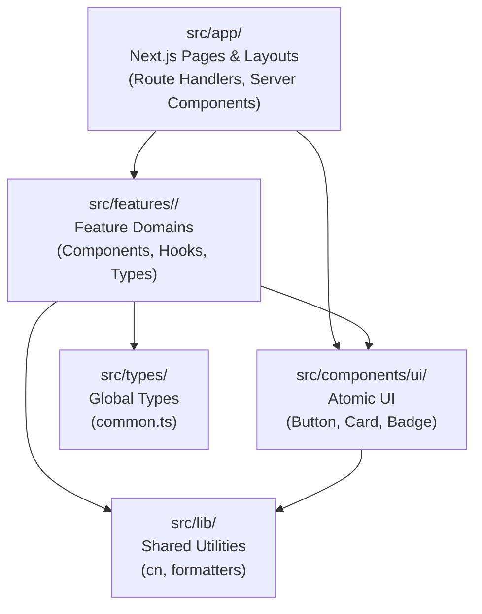

# Architecture Overview - Vibe Studio

## 1. Core Principles

- **Domain-Driven Modularization:** Group features by business capability (`src/features/<domain>/`) rather than technical type alone.
- **Server-First Rendering:** Pages in `src/app/` are React Server Components by default. Interactivity is isolated to small client boundaries with `"use client"`.
- **Zero Accidental Complexity (YAGNI):** No speculative repositories, factory patterns, or single-method interfaces. Write straightforward, readable TypeScript functions and components.
- **One Source of Truth:** State lives at the lowest common ancestor or in lightweight React state. No duplicated sync state.

## 2. Directory Architecture & Layer Responsibilities

### Layer Details:
1. **`src/app/`:**
   - Handles URL routing, metadata, page layouts, and HTTP API route handlers.
   - Orchestrates feature modules and UI components.
2. **`src/features/<domain>/`:**
   - Self-contained slices of functionality (e.g. `prompt-studio`).
   - Owns domain-specific types, UI components, and state management.
3. **`src/components/ui/`:**
   - Generic, brand-consistent atomic components (Buttons, Cards, Badges).
   - Stateless, styled via Tailwind CSS, accessible.
4. **`src/lib/`:**
   - Framework-agnostic pure utility functions (e.g. `cn` class merger).
5. **`tests/`:**
   - `tests/unit/`: Direct validation of pure functions, helpers, and isolated components.
   - `tests/integration/`: End-to-end integration flows across routes and features.
